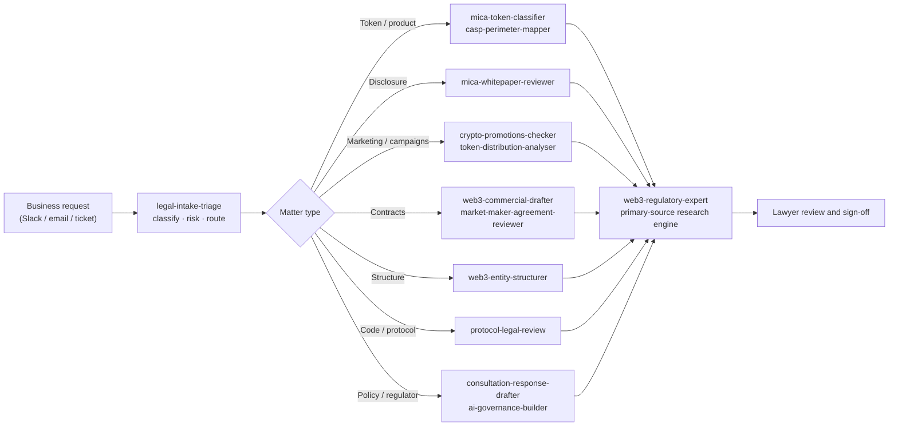

# lowyr — Legal AI skills for crypto, web3 and in-house legal teams

**lowyr** is a Claude plugin marketplace of 14 legal skills, grouped into four plugins. They cover the core work of a blockchain and crypto-asset lawyer:

- EU and UK crypto-asset regulation
- web3 commercial transactions
- the legal reading of smart contracts
- legal operations

Each skill is a structured, auditable workflow, not a prompt. It sets out what to check, in what order, against which legal source, and what the output must contain.

> Built and maintained by **Bastien Choquez**.

---

## Why this exists

Crypto-asset law is new and fast-moving, and it turns on technical detail. The errors that hurt are rarely exotic. They come from:

- citing an article number from memory
- accepting a "decentralised" or "utility token" label at face value
- missing one exemption condition
- not reading the smart contract

These skills build the disciplines of careful legal practice into AI-assisted workflows:

- **Primary-source verification.** Every skill must read the current legal text before citing it. The baseline of statutory references hard-coded in the skills is recorded, with sources and the verification date, in the [citation register](docs/citation-register.md).
- **Three registers, never blended:** what the law says, what regulators say about it, and the analysis itself.
- **Substance over labels:** tokens are classified on their rights and functions, and protocols on who actually controls them.
- **Outputs a business can use:** decision memos, gap tables, redlines, RAG reviews and structure charts. Not essays.

## How AI fits into the legal workflow



AI handles decomposition, the first draft, checklist coverage and cross-referencing. The lawyer handles judgement, verification, the client relationship and sign-off. Every skill ends with a sources section and an explicit list of open points, so the human review starts in the right place.

## Catalogue

### `lowyr-crypto-regulatory`

| Skill | What it does |
|---|---|
| **mica-token-classifier** | Auditable MiCA decision tree. It tests NFT and financial-instrument exclusions (ESMA qualification guidelines), then EMT, ART and other crypto-asset/utility token, then the Art 4 offer exemptions. Output is a classification memo with counter-arguments and the facts that would change the result. |
| **mica-whitepaper-reviewer** | Checks a white paper line by line against Art 6, Annex I and the ITS 2024/2984 templates. Output is a defect table with severity, the provision breached, the fix, and points of Art 15 liability exposure. |
| **casp-perimeter-mapper** | Maps each product function to one of the ten MiCA crypto-asset services. Covers exemptions, Recital 22 decentralisation, reverse solicitation, passporting and the obligations that follow, with an optional UK overlay. |
| **crypto-promotions-checker** | Rates marketing claims GREEN, AMBER or RED under MiCA Arts 7, 29, 53 and 66 and UK financial promotions rules, and suggests compliant rewrites. Also covers prize-draw and gambling rules, influencers and sports-partnership overlays. |
| **token-distribution-analyser** | Covers airdrops, rewards, staking, loyalty and points programmes, mechanic by mechanic and jurisdiction by jurisdiction. Includes the "not free" trap in Art 4(3), the Art 4(4) admission-to-trading trap, and design changes that reduce risk. |
| **consultation-response-drafter** | Turns a regulator consultation into a question map, position matrix, evidence list, draft response, executive summary and cover note. |
| **web3-regulatory-expert** | A nine-step, multi-jurisdiction research workflow built on primary sources. It is the research engine behind the other skills. |

### `lowyr-web3-transactions`

| Skill | What it does |
|---|---|
| **web3-commercial-drafter** | Drafts and reviews MoUs, partnership, listing, licence, SaaS and validator agreements, using a token-aware [clause library](plugins/lowyr-web3-transactions/skills/web3-commercial-drafter/references/clause-library.md). The library covers regulatory events, chain events, token consideration, sanctions and smart-contract risk. |
| **market-maker-agreement-reviewer** | Reviews token loan and call option economics, defines measurable KPIs, and checks wash-trading and insider risks against MiCA Title VI (Arts 86–92). |
| **web3-entity-structurer** | Designs group structures function by function, compares jurisdictions, and produces substance requirements, structure charts and a roadmap. |

### `lowyr-protocol-legal`

| Skill | What it does |
|---|---|
| **protocol-legal-review** | Reads Solidity code and on-chain state to map who controls what: admin keys, proxies, pause, mint, bridges and governance. It then turns that control into legal consequences: decentralisation claims, custody, disclosure gaps and liability. |
| **web3-legal-expert** | A combined legal and technical expert, and the front door to the marketplace. Covers SAFTs, DAO wrappers, US securities analysis, security audits, tokenomics, GDPR on-chain and open-source IP. |

### `lowyr-legal-ops`

| Skill | What it does |
|---|---|
| **ai-governance-builder** | Builds an AI code of ethics, an acceptable-use standard, a tool-approval procedure, a vendor due-diligence questionnaire and an AI literacy plan. Aligned with the EU AI Act as amended by the 2026 Digital Omnibus. |
| **legal-intake-triage** | Classifies incoming business requests, rates risk and urgency, sets SLAs, identifies missing information, routes the matter to the right skill and drafts the first reply. |

## Installation

In Claude Code:

```
/plugin marketplace add lawgic-ally/lowyr
/plugin install lowyr-crypto-regulatory@lowyr
/plugin install lowyr-web3-transactions@lowyr
/plugin install lowyr-protocol-legal@lowyr
/plugin install lowyr-legal-ops@lowyr
```

Skills trigger automatically from their descriptions, for example "Is this token in scope of MiCA?" or "Review this market-making agreement". You can also invoke a skill by name.

## Repository layout

```
.claude-plugin/marketplace.json      # marketplace manifest
plugins/<plugin>/.claude-plugin/plugin.json
plugins/<plugin>/skills/<skill>/SKILL.md
plugins/<plugin>/skills/<skill>/references/   # decision trees, checklists, clause libraries
docs/citation-register.md            # verified statutory baseline
```

## Important

These skills support qualified lawyers. They do not provide legal advice and do not replace it. Read the [disclaimer](DISCLAIMER.md). The skills contain no client, employer or confidential information. They are built only from public legislation, regulator publications and general professional know-how.

## Licence

© 2026 Bastien Choquez. All rights reserved. See [LICENSE](LICENSE).
