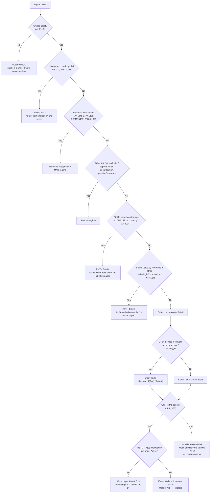

# MiCA classification decision tree (baseline)

Baseline verified 17 November 2026 against EUR-Lex and the ESMA Interactive Single Rulebook. Re-verify each node before relying on it.

## Node checklist

| Node | Key evidence to collect |
|---|---|
| Crypto-asset | DLT record, transferability, storage |
| Unique/non-fungible | Uniqueness of token AND of underlying right; series size; fractionalisation; secondary-market behaviour |
| Financial instrument | Profit/revenue rights, voting on issuer, repayment claims, negotiability, standardisation, derivatives features |
| EMT | Peg target, redemption promise, marketing language |
| ART | Basket/commodity/crypto reference, reserve, stabilisation mechanism |
| Utility token | Exclusivity of access function; good/service live or not |
| Offer to the public | Communication + sufficient information to decide to purchase; persons targeted; Member States |
| Exemptions | Counting persons per MS, consideration over 12 months, qualified investors, free vs data/fees, limited network size |
